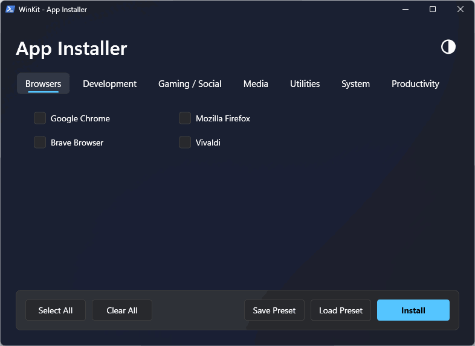

<div align="center">

# ⚡ WinKit

### Modern Windows 11 Fluent App Installer & WinGet Store

[](LICENSE)
[](https://www.microsoft.com/windows)
[](https://github.com/microsoft/winget-cli)

**🇺🇸 English** | **[🇷🇺 Русский](README.ru.md)**

<br>



<br>

**Skip the boring setup.** WinKit is a sleek, modern Windows 11 Fluent GUI app installer powered by WinGet. Pick all the apps you need across categories or search the entire WinGet repository directly from the app, then install them all in one go — no clicking through wizards, no hunting for downloads.

</div>

---

## 🚀 Quick Start

**One-liner (PowerShell):**
```powershell
irm https://raw.githubusercontent.com/Refyrd/WinKit/main/install.ps1 | iex
```

*This will download and launch the WinKit WPF GUI directly.*

### Or clone the repo

```bash
git clone https://github.com/Refyrd/WinKit.git
cd WinKit
powershell -ExecutionPolicy Bypass -File winkit.ps1
```

---

## ✨ Features & Highlights

- 🌐 **WinGet Online Search**: Search and install ANY application directly from the official WinGet catalog without leaving the app.
- 🪟 **Native Windows 11 Mica Backdrop**: Translucent glass background integrating seamlessly with Windows 11 desktop theme.
- 🌓 **Dynamic Light & Dark Themes**: Auto-detects system theme on launch and includes an instant toggle button.
- 🎨 **Modern WPF Fluent UI**: Rounded tab categories, vector checkmarks, custom buttons, and smooth hover states.
- 🔢 **Dynamic Selection Counter**: Real-time app counter on the Install button (`Install (5)`).
- 💾 **Custom Preset Management**: Save and load custom selection sets with native file dialogs.
- 🛡️ **Smart Elevation & Fallbacks**: Auto-elevates to Administrator while gracefully falling back to user-space execution for sensitive apps (Discord, Telegram, Spotify).
- ⚡ **One-Click Batch Install**: Select apps across multiple categories and install them all via WinGet concurrently.

---

## 🎯 Features

| Feature | Description |
|---------|-------------|
| 🌐 **WinGet Search** | Online search directly into the official WinGet repository |
| 🖥 **Modern WPF GUI** | Clean Fluent Design interface built natively with WPF |
| 🪟 **Mica Blur** | Native DWM Mica background effect for Windows 11 |
| 🌓 **Light & Dark Mode** | Automatic OS theme detection + live switch button |
| 🗂 **Categorized Tabs** | Browsers, Development, Gaming, Media, Utilities, System, Productivity |
| 💾 **Preset Support** | Save and load selection presets via native file picker |
| 📦 **Batch Controls** | Quick `Select All` and `Clear All` buttons with live counter |
| 📊 **Progress & Logs** | Live download progress bar, streaming output, and exportable logs |
| 🛡 **Auto-Elevate** | Requests administrator privileges automatically |

---

## 📦 Built-in Catalog (42+ Apps) + WinGet Store

| Category | Included Applications |
|----------|-----------------------|
| 🌐 **Browsers** | Google Chrome, Mozilla Firefox, Brave Browser, Vivaldi |
| 💻 **Development** | VS Code, Git, Python 3, Node.js LTS, Notepad++, Docker Desktop, Figma |
| 🎮 **Gaming / Social** | Steam, Epic Games, Discord, TeamSpeak 3, TeamSpeak 6 Beta, Telegram, Roblox |
| 🎬 **Media** | VLC Media Player, Spotify, OBS Studio, K-Lite Codec Pack, Audacity, GIMP |
| 🛠 **Utilities** | 7-Zip, WinRAR, qBittorrent, MSI Afterburner, PowerToys, Everything, Rufus, ShareX, Revo Uninstaller, WizTree |
| ⚙️ **System** | DirectX Web Setup, Visual C++ Redist, CPU-Z, GPU-Z, HWMonitor, CrystalDiskInfo |
| 📝 **Productivity** | Obsidian, Notion |

> 💡 **Want to add your own permanent apps?** Edit [`src/config/Apps.ps1`](src/config/Apps.ps1) — add `Name`, `Id`, and `Cat` into the `$global:apps` array.

---

## 📋 Requirements

- **Windows 10** (version 1709+) or **Windows 11**
- **WinGet** — pre-installed on Windows 11; automatically bootstrapped if missing on stripped OS editions.

---

## 🤝 Contributing

1. Fork this repo
2. Add new apps to [`src/config/Apps.ps1`](src/config/Apps.ps1)
3. Submit a pull request

---

## 📄 License

[MIT](LICENSE) — do whatever you want with it.

---

<div align="center">

**Made with ❤️ by [Refyrd](https://github.com/Refyrd)**

</div>
