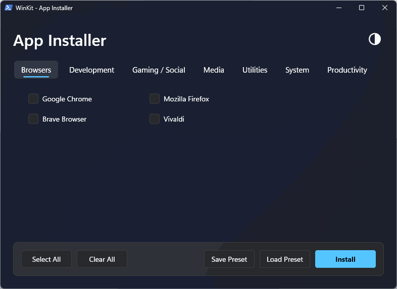

<div align="center">

# ⚡ WinKit

### Современный инсталлятор приложений для Windows 11 и WinGet Каталог

[](LICENSE)
[](https://www.microsoft.com/windows)
[](https://github.com/microsoft/winget-cli)

**[🇺🇸 English](README.md)** | **🇷🇺 Русский**

<br>



<br>

**Забудьте про рутину.** WinKit — это стильный GUI-инсталлятор приложений в дизайне Windows 11 Fluent UI на базе WinGet. Выбирайте программы по категориям или ищите любые приложения напрямую в официальном репозитории WinGet, а затем устанавливайте их в один клик.

</div>

---

## 🚀 Быстрый старт

**Одна команда (PowerShell):**
```powershell
irm https://raw.githubusercontent.com/Refyrd/WinKit/main/install.ps1 | iex
```

*Скрипт скачает и сразу откроет графическое окно WinKit.*

### Или клонируй репозиторий

```bash
git clone https://github.com/Refyrd/WinKit.git
cd WinKit
powershell -ExecutionPolicy Bypass -File winkit.ps1
```

---

## ✨ Ключевые особенности

- 🌐 **Онлайн-поиск WinGet**: Поиск и установка ЛЮБОГО приложения напрямую из официального каталога WinGet прямо в интерфейсе программы.
- 🪟 **Нативный эффект Mica**: Полупрозрачный размытый фон в стиле Windows 11.
- 🌓 **Светлая и тёмная темы**: Автоматическое определение системной темы при старте и кнопка мгновенного переключения на лету.
- 🎨 **Современный WPF Fluent UI**: Скруглённые вкладки категорий, векторные галочки чекбоксов, стильные кнопки и плавные эффекты наведения.
- 🔢 **Динамический счетчик**: Отображение точного количества выбранных программ прямо на кнопке (`Установить (5)`).
- 💾 **Управление пресетами**: Сохранение и загрузка списка выбранных программ через стандартные диалоговые окна выбора файла.
- 🛡️ **Умное управление правами**: Автозапрос прав администратора с безопасным переключением на пользователя для капризных приложений (Discord, Telegram, Spotify).
- ⚡ **Пакетная установка**: Выбирайте приложения из разных вкладок и устанавливайте всё разом.

---

## 🎯 Возможности

| Функция | Описание |
|---------|----------|
| 🌐 **Поиск WinGet** | Полноценный онлайн-поиск по официальному репозиторию пакетов |
| 🖥 **Современный WPF GUI** | Чистый интерфейс в стиле Fluent Design на WPF |
| 🪟 **Эффект Mica** | Нативный блюр-эффект Windows 11 через DWM API |
| 🌓 **Светлая / Тёмная тема** | Авто-определение темы OS + кнопка ручного переключения |
| 🗂 **Вкладки категорий** | Браузеры, Разработка, Игры/Соцсети, Медиа, Утилиты, Система, Продуктивность |
| 💾 **Поддержка пресетов** | Быстрое сохранение и загрузка наборов через системный диалог |
| 📦 **Пакетное управление** | Кнопки `Выбрать всё` и `Очистить всё` с динамическим счетчиком |
| 📊 **Прогресс и логи** | Индикатор скачивания в реальном времени, поток логов и экспорт в файл |
| 🛡 **Авто-права** | Автоматический запрос прав администратора при запуске |

---

## 📦 Встроенный каталог (42+ приложений) + WinGet Каталог

| Категория | Включенные приложения |
|-----------|-----------------------|
| 🌐 **Браузеры** | Google Chrome, Mozilla Firefox, Brave Browser, Vivaldi |
| 💻 **Разработка** | VS Code, Git, Python 3, Node.js LTS, Notepad++, Docker Desktop, Figma |
| 🎮 **Игры / Общение** | Steam, Epic Games, Discord, TeamSpeak 3, TeamSpeak 6 Beta, Telegram, Roblox |
| 🎬 **Медиа** | VLC Media Player, Spotify, OBS Studio, K-Lite Codec Pack, Audacity, GIMP |
| 🛠 **Утилиты** | 7-Zip, WinRAR, qBittorrent, MSI Afterburner, PowerToys, Everything, Rufus, ShareX, Revo Uninstaller, WizTree |
| ⚙️ **Система** | DirectX Web Setup, Visual C++ Redist, CPU-Z, GPU-Z, HWMonitor, CrystalDiskInfo |
| 📝 **Продуктивность** | Obsidian, Notion |

> 💡 **Хотите добавить свои постоянные программы?** Отредактируйте [`src/config/Apps.ps1`](src/config/Apps.ps1) — добавьте `Name`, `Id` и `Cat` в массив `$global:apps`.

---

## 📋 Требования

- **Windows 10** (версия 1709+) или **Windows 11**
- **WinGet** — предустановлен в Windows 11; автоматически подгружается при отсутствии на урезанных сборках ОС.

---

## 🤝 Вклад в проект

1. Сделайте форк репозитория
2. Добавьте новые приложения в [`src/config/Apps.ps1`](src/config/Apps.ps1)
3. Отправьте pull request

---

## 📄 Лицензия

[MIT](LICENSE) — делайте что хотите.

---

<div align="center">

**Сделано с ❤️ автором [Refyrd](https://github.com/Refyrd)**

</div>
